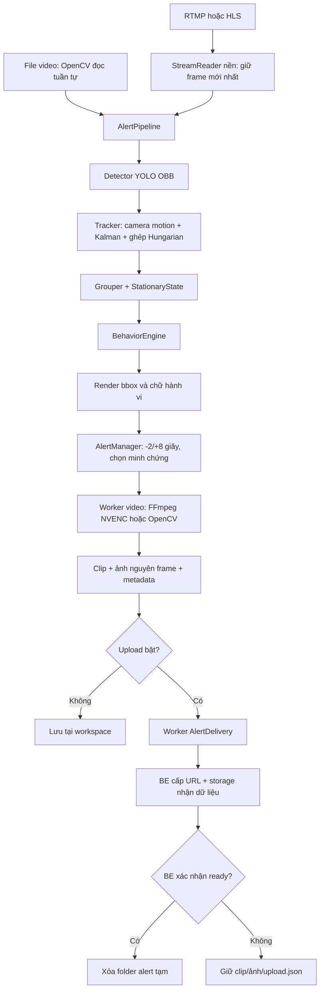
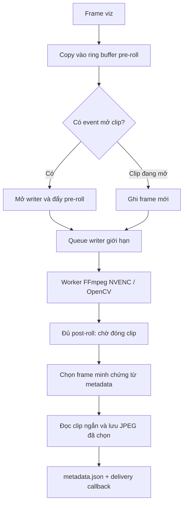
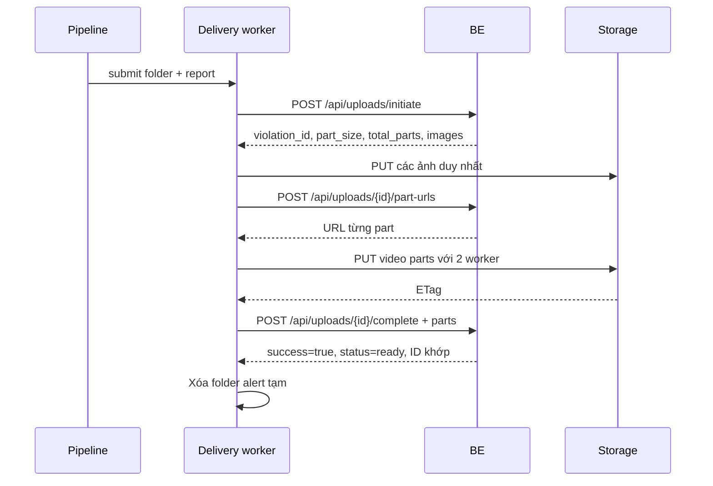

# Kiến trúc hệ thống TPV UAV — nhánh ver3OBB

Tài liệu mô tả code local tại ngày **23/11/2026**, sau khi tích hợp OBB và tối ưu bước ghép tracking. Cấu hình thực tế trên server có thể đã được chỉnh riêng; các giá trị bên dưới là mốc của bản local, không phải giá trị cố định trong mọi lần chạy.

## 1. Phạm vi và cách đọc

Hệ thống nhận file video hoặc RTMP/HLS, phát hiện đối tượng bằng YOLO OBB, theo dõi ID, gom nhóm quan hệ, gán hành vi, rồi tạo clip/ảnh minh chứng và tùy chọn upload BE.

Ba lớp ID độc lập:

| ID | Nguồn tạo | Ý nghĩa |
|---|---|---|
| `track_id` | `Tracker` | Một đối tượng theo thời gian trong một phiên camera |
| `group_id` | `Grouper` | Một nhóm đối tượng; chữ `G` khi chưa có hành vi, `B` khi đã có hành vi |
| `event_id` / `package_id` | `AlertManager` | Một lần cảnh báo theo nhóm + tên hành vi / một cửa sổ clip chứa nhiều sự kiện |

`B14` sử dụng chính `group_id=14`, không có bộ đếm behavior ID riêng. Đổi tên hành vi trên cùng nhóm không đổi B-ID, nhưng có thể tạo event mới vì khóa cảnh báo chứa tên hành vi.

Hiện hệ thống suy ra nhiều hành vi từ thành phần nhóm. Không có module segmentation vỉa hè, bản đồ vùng cấm hay kiểm chứng pháp lý trong pipeline này. MobileNet phân loại rửa/sửa xe từ crop, không phải nhận dạng hành động theo chuỗi video.

## 2. Luồng tổng thể



Detection chỉ chạy khi đến lịch `detect_fps`. Tracking/grouping/behavior/render vẫn được cập nhật trên mỗi frame **được pipeline xử lý**. Stream có thêm frame lặp ở khâu ghi alert; những frame này không chạy lại detection/tracking.

## 3. Điểm chạy và cây mã nguồn

```text
run_video.py                    # File video → alert
run_stream.py                   # RTMP/HLS → alert
src/
  pipeline/                     # Điều phối và nguồn stream
  detection/                    # YOLO, lọc box, nhãn, render
  tracking/                     # ID đối tượng và bù chuyển động
  grouping/                     # Quan hệ nhóm và trạng thái đứng yên
  behavior/                     # Rule hành vi và MobileNet
  alerts/                       # Clip/ảnh/metadata và client BE
  core/                         # Cấu hình, hình học, timer, writer
configs/                        # Model, ngưỡng, nguồn, encoder, API
scripts/                        # Export TensorRT và benchmark phụ trợ
test/                          # Test tổng hợp và runner kiểm thử video/ảnh
```

Các file `__init__.py` trong bảy package `core`, `pipeline`, `detection`, `tracking`, `grouping`, `behavior`, `alerts` đánh dấu package/import; không tự khởi động model hay worker. Các entrypoint thêm `src` vào `sys.path` để chạy trực tiếp từ checkout.

| File ở gốc | Vai trò |
|---|---|
| `run_video.py` | Gọi `pipeline.runner.main('video')` |
| `run_stream.py` | Gọi `pipeline.runner.main('stream')` |
| `pyproject.toml` | Khai báo package `uav-analysis`, tìm package trong `src`, dependencies lấy từ `requirements.txt` |
| `requirements.txt` | Torch/Ultralytics, OpenCV, Shapely, SciPy, Pillow, YAML, requests, dotenv… |
| `.env.example` | Mẫu `TPV_UPLOAD_API_KEY`, `UAV_STREAM_URL`, `UAV_VIZ_URL`; không chứa key thật |
| `.gitignore` | Bỏ môi trường, models/data/outputs và `.env`; cho phép `.env.example` |
| `README.md` | Hướng dẫn chạy, thay đổi và ví dụ; tài liệu này giải thích kiến trúc chi tiết |
| `docs/server.md` | Hướng dẫn môi trường/deploy server có sẵn; đường dẫn cần chọn theo phiên bản |

## 4. Quy ước dữ liệu và thời gian

### 4.1 Ảnh và hình học

- Frame là `numpy.ndarray`, `uint8`, thứ tự màu **BGR**, shape `(height, width, 3)`.
- Tọa độ box/polygon theo **pixel ảnh nguồn**, không phải ảnh đã resize vào model.
- `bbox_xyxy = [x_min, y_min, x_max, y_max]`: AABB bao ngoài, dùng cho crop và tương thích thuật toán cũ.
- `bbox_polygon = [[x1,y1],…,[x4,y4]]`: bốn đỉnh OBB; dùng để vẽ và đo hình học.
- `bbox_xywhr = [cx,cy,w,h,angle]`: góc tính bằng **radian**. Khi tracker gắn lại polygon, góc/kích thước được suy ra bằng `minAreaRect`; biểu diễn góc có thể khác quy ước trực tiếp của YOLO nhưng polygon vẫn là hình học chính.
- Box nhóm có thể là hình chữ nhật xoay bao toàn bộ thành viên, không phải OBB model tự dự đoán cho cả nhóm.

Ví dụ detection:

```json
{
  "label": "Xe máy",
  "confidence": 0.91,
  "bbox_xyxy": [100, 120, 220, 260],
  "bbox_polygon": [[140,120],[220,160],[180,260],[100,220]],
  "bbox_xywhr": [160,190,89.4,107.7,0.46]
}
```

Các số trên minh họa cấu trúc, không phải mẫu hình học chuẩn để kiểm thử.

### 4.2 Các loại thời gian

| Loại | Nguồn | Dùng cho |
|---|---|---|
| Timeline media | `frame_index / fps` | Clip/event; file video bình thường cũng dùng cho lịch detect/track/dwell |
| Đồng hồ quan sát | Timestamp tích lũy, trừ khoảng PAUSE khi resume | Tracking/grouping/cache, confirmation/rearm; không cộng thời gian nguồn mất |
| Stream timestamp | `time.monotonic()` khi nhận frame, quy đổi sang slot output | Lịch xử lý/clip live, không phải capture PTS camera |
| Thời gian sự kiện gửi BE | Mốc `started_at` có múi giờ + `alert_time` | `detected_at` |
| Wall time xử lý | `time.perf_counter()` | FPS xử lý và bảng thời gian |

Video chạy chậm hơn realtime không làm clip bị tua chậm: clip ghi FPS nguồn. Với file không có `--recording-start`, mốc sự kiện BE mặc định là lúc chạy pipeline, không phải lúc camera quay file.

## 5. Module `pipeline`

### 5.1 Input/output

| Input | Output |
|---|---|
| CLI, các YAML, `.env`, frame video/stream | Alert folder, callback delivery, `summary.json`, log thời gian |

### 5.2 Từng file

| File | Thành phần | Trách nhiệm |
|---|---|---|
| `src/pipeline/runner.py` | `main`, `AlertPipeline`, `measure` | Nạp cấu hình, chọn nguồn, lịch detect, gọi các module, đóng tài nguyên, thống kê |
| `src/pipeline/stream.py` | `StreamReader` | Đọc RTMP/HLS ở thread riêng, queue 1 frame, timeout/reconnect, polling và FPS nguồn |
| `src/pipeline/publish.py` | `RTMPPublisher` | Phát viz RTMP bằng worker, queue 2 bỏ cũ, encoder độc lập clip |
| `src/pipeline/__init__.py` | Package | Mô tả package |

### 5.3 Khởi tạo và xử lý frame

`main()` nạp `.env` tại gốc dự án bằng `load_dotenv(..., override=False)`: biến môi trường có sẵn được ưu tiên. Tạo thư mục output riêng theo ngày giờ Việt Nam rồi tạo `AlertDelivery`.

`AlertPipeline` tạo detector, timer, tracker, grouper, behavior, font, manager cảnh báo. Các config tracking/grouping/behavior được lấy từ `ROOT/configs/…`; `--config` chỉ chọn detection/output, không tự chọn một bộ YAML cùng tên.

Mỗi `process(frame,index,resume=False)`:

1. Tính timeline media và đồng hồ quan sát. Sau tạm ngưng, đồng hồ quan sát chỉ tiến một frame thay vì cộng cả gap. Tính slot detect theo đồng hồ quan sát và `detect_fps`; resume luôn buộc detect.
2. Đến slot mới: detect và đo thời gian. Chưa đến slot: truyền `detections=None`.
3. Tracker → kiểm tra ghép lại khi resume → Grouper → BehaviorEngine. Không ghép được ID cũ thì reset lịch sử và log; nhóm không dùng dự đoán cũ chưa ghép lại làm bằng chứng ở lượt resume.
4. Chỉ giữ nhóm có `behaviors` để render và đưa vào alert; không vẽ object/nhóm chưa có hành vi trong runner thật.
5. Stream thiếu slot: đưa frame viz trước đó vào manager với `observed=False`, không metadata bằng chứng/event mới; frame thật truyền `observation_time` và `observation_seconds`. Publisher nhận frame viz thật ở worker riêng.
6. Ghi thống kê; mỗi 100 frame xử lý báo FPS wall time. Vòng stream mỗi 5 giây còn báo FPS nguồn khai báo, FPS nhận thực trong 5 giây và FPS xử lý.

`close()` finalize alert, đóng detector và in các stage. `main()` còn chờ delivery worker hoàn tất trước khi ghi summary. `elapsed_seconds` từng phiên pipeline không bao gồm toàn bộ thời gian chờ upload cuối của `main()`.

**Khác runner test:** `AlertPipeline` khởi tạo tracking/grouping trực tiếp, không dùng `enabled` của hai YAML để bỏ khởi tạo như `test_obj_detection.py`. `behavior.enabled` vẫn được engine kiểm tra. Muốn test detect-only dùng wrapper chuyên dụng.

### 5.4 Stream biến động FPS, mất mạng

- Ưu tiên nguồn: `--input` → biến có tên trong `stream.input_env` → RTMP/HLS trong YAML. Biến `UAV_STREAM_URL` được đặt sẽ ưu tiên cả khi chọn `--source hls`.
- URL HTTP(S) kết thúc `/` tự thêm `index.m3u8`. Đây là giả định đường dẫn playlist, cần xác nhận khi camera phát.
- Reader queue **1**: đầy thì bỏ frame cũ, không để backlog tích lũy.
- Output index là `round((moment-origin)*output_fps)`. Cùng slot thì bỏ qua; nguồn nhanh hơn output sẽ giảm số frame xử lý.
- Khi nguồn chậm/AI chậm: clip CFR có frame lặp, nhưng `observed=False` không chạy lại AI, không tạo event, không cộng thời gian ảnh minh chứng.
- `pause_gap_seconds=1.0`: mất frame lâu hơn mốc này hoặc reconnect ngắn thì PAUSE; giữ lịch sử/ID, không cộng khoảng mất nguồn vào đồng hồ bằng chứng. `reset_gap_seconds=10.0`: quá mốc này thì finalize phiên cũ/reset trạng thái; giữ Detector và MobileNet/classifier.
- Reader polling khoảng 0.5 giây để vòng chính kiểm tra mất nguồn ngay cả khi chưa có frame mới; bỏ item quá cũ theo pause threshold. Sau khởi tạo/reset phiên lấy frame mới nhất thay vì xử lý frame đã giữ trong lúc chờ.
- Frame trở lại sau PAUSE buộc detect; ghép được ID cũ thì RESUME. ID cũ chưa ghép không được dùng như quan sát mới. Không ghép được hoặc scene cut thì reset tracking/grouping/cache hành vi/lịch cảnh báo và ghi `[RESET]` kèm lý do. Log có `[PAUSE]` và `[RESUME]`.
- Tracking/grouping/behavior dùng đồng hồ quan sát đã trừ gap. Alert nhận đồng hồ quan sát riêng cho confirmation/rearm, còn event/clip vẫn theo timeline media. Cache hành vi vẫn giữ qua PAUSE, buộc đủ điều kiện detection mới để phân loại lại lúc tiếp tục.
- `epoch` tăng khi reader mở lại nguồn; đổi epoch không tự reset toàn bộ như trước. `timeout_ms` và `reconnect_seconds` độc lập với hai mức gap.
- FPS nguồn khai báo từ `CAP_PROP_FPS`, FPS nhận từ cửa sổ thời điểm nhận trước queue bỏ cũ. Đây không phải capture PTS; FPS khai báo có thể sai, FPS nhận về 0 nếu hơn 2 giây không nhận frame.
- Nếu độ phân giải thay đổi giữa một clip đang mở, writer hiện không tự đổi kích thước và có thể báo lỗi; không có nhánh tự reset theo resolution.

## 6. Module `detection`

### 6.1 Input/output và từng file

| File | Input | Output / vai trò |
|---|---|---|
| `detector.py` — `Detector` | Detection config, BGR frame | `list[dict]` detection đã lọc nhãn, confidence, kích thước và box trùng |
| `labels.py` | Tên lớp checkpoint | `LABELS` nghiệp vụ và `PHRASE_LABELS` ánh xạ tên tương đương |
| `render.py` | Frame, detection/track, groups, font | Bản sao frame đã viz; không sửa frame đầu vào |
| `parallel.py` — `ParallelEngines` | Nhiều engine cố định, frame | Các kết quả theo từng engine trên CUDA stream riêng; đường cũ cho detect AABB |
| `predictor.py` — `BoxesOnlyPredictor` | Output segmentation checkpoint | Chỉ dựng box, bỏ mask; phục vụ tương thích checkpoint cũ |
| `__init__.py` | — | Package |

### 6.2 Nạp model và lọc

Nhánh hiện tại khai báo `task: obb`, dùng `yolo26m_obb.pt` trên local hoặc `.engine` trên server. Detector kiểm tra đủ 13 nhãn nghiệp vụ sau ánh xạ, bỏ lớp `Xe hàng rong`/`Xe bán hàng rong` ngoài danh mục.

| Tên checkpoint tương đương | Nhãn hệ thống |
|---|---|
| Biển báo | Biển quảng cáo |
| Cây | Thân cây |
| Hàng hóa | Hàng hóa bày bán |
| Thiết bị máy móc | Máy móc |
| Xe rác | Phương tiện thu gom, vận chuyển rác |

ID nghiệp vụ 1..13 không phải chỉ số 0..13 trong checkpoint. `PHRASE_LABELS` ở bản mới là mapping tên lớp, không gửi prompt văn bản cho model.

`_predict_one()` gọi Ultralytics: resize/letterbox theo `imgsz`/`rect`, predict, hậu xử lý và quy đổi tọa độ về ảnh nguồn. Nếu OBB: đọc `result.obb.xyxy`, `xyxyxyxy`, `xywhr`, `conf`, `cls`; AABB cũ đọc `result.boxes`.

Sau đó:

1. Chọn nhãn cho phép; threshold riêng ghi đè confidence mặc định.
2. `_valid_box()` lọc kích thước trước tracking. OBB dùng cạnh ngắn/chiều rộng ảnh, cạnh dài/chiều cao ảnh và diện tích polygon/diện tích ảnh. Vì ý nghĩa khác width/height AABB, ngưỡng ver2 chỉ là mốc cần kiểm tra thực tế.
3. `_merge()` sắp confidence giảm dần; chỉ loại cùng nhãn khi IoU vượt `merge_iou` hoặc IoS ≥ `merge_ios`. IoS là giao/diện tích box nhỏ hơn. OBB dùng giao lồi OpenCV, AABB dùng giao hình chữ nhật.

NMS model `nms_iou` và `_merge()` là hai tầng riêng. Không có NMS chéo nhãn trong `_merge()`. Không tự sửa góc OBB nếu model dự đoán gần thẳng trục.

OBB hiện không hỗ trợ nhánh `parallel_models=true`; cấu hình một model và chạy tuần tự. `parallel.py` vẫn giữ để tương thích hệ hai engine detect cũ.

### 6.3 Render

- Font Unicode mặc định **30 px**, cache patch chữ tối đa 1024 mục.
- Chữ RGB `(255,255,0)`, bbox BGR `(0,255,255)`: **vàng**.
- Object/track vẽ polygon nếu có, ngược lại vẽ AABB. Text có nhãn/confidence, thêm ID và trạng thái đứng yên khi được truyền vào.
- Nhóm/hành vi vẽ polygon nhóm nếu có, text đặt phía trên AABB, chặn vào biên ảnh.
- Mode `group_ids_only`: `B{id} <tên hành vi>`; nhóm chưa có hành vi là `G{id}` (máy móc có mô tả riêng).
- Bỏ hậu tố “(nghi vấn)” ở text, nhưng metadata vẫn có thể giữ `status='suspected'`.
- Các comment/docstring cũ có chỗ còn ghi “đỏ”; màu thực thi hiện là vàng trong `render.py`.

## 7. Module `tracking`

### 7.1 Hợp đồng

```text
Tracker.update(frame, timestamp, detections)
  detections = None : không chạy detector trên frame này
  detections = []   : đã detect nhưng không thấy đối tượng
  detections = [...] : quan sát mới
→ list track đã confirmed và còn trong thời hạn xuất
```

Track ngoài detection có thêm:

```text
track_id, position_source, detection_age_seconds,
observed_bbox_xyxy, observed_bbox_polygon (nếu OBB)
```

`tracker.last_motion` đưa sang grouping:

```text
matrix: affine 2×3; reliable; scene_cut; reason;
local_boxes: {track_id: AABB được flow cập nhật}
```

### 7.2 Từng file

| File | Vai trò |
|---|---|
| `tracker.py` | Kalman 8 chiều `[cx,cy,w,h,vx,vy,vw,vh]`, cost ghép, Hungarian, lifecycle ID, truyền polygon |
| `motion.py` | Thu nhỏ/gray, phát hiện scene cut, LK hai chiều, RANSAC affine camera, flow vùng object, warp box |
| `__init__.py` | Package |

### 7.3 Thứ tự xử lý và ID

1. Bắt buộc timestamp tăng. Lấy các box track đủ mới để loại foreground khỏi nền camera.
2. Tính camera motion; scene cut xóa track nhưng bộ đếm ID tiếp tục tăng trong cùng tracker.
3. Xóa track quá `max_lost_seconds`.
4. Với từng track: warp camera → Kalman prediction → optical flow riêng nếu có → đưa polygon theo vị trí/kích thước dự đoán.
5. Có detection: tính ma trận cost → Hungarian → bỏ cặp vô hiệu → cập nhật Kalman/covariance, confidence, observed box/polygon; tạo track cho detection chưa ghép.
6. Chỉ xuất track confirmed và age ≤ `max_prediction_seconds`.

`min_hits=2`: cần hai detection ghép để xác nhận. Track chưa confirmed bị hụt ghép trên lượt detect sẽ reset hits. Source có thể là `detection`, `optical_flow`, `camera_motion`, `prediction`; prediction thuần không được grouping dùng làm bằng chứng mới.

Góc được nhận trực tiếp từ detection. Giữa hai detection, polygon được affine camera rồi dịch/scale theo AABB dự đoán; chưa có Kalman góc hay mô hình chuyển động xoay riêng. `observed_*` giữ quan sát detection cuối, tách khỏi box dự đoán.

### 7.4 Ghép OBB sau tối ưu

- AABB cost được vector hóa làm fallback.
- `_obb_geometry()` chuẩn bị **một lần mỗi track/detection**: kiểm tra hữu hạn/bốn đỉnh, làm tròn 0.001 pixel, convex hull, diện tích, tâm, kích thước cạnh, đường chéo và bounds.
- Cặp khác nhãn bỏ qua. Cặp thay đổi kích thước ≥0.8 theo max log-ratio không hợp lệ.
- Cặp xa chỉ loại sớm nếu cận trên IoU từ AABB/diện tích cũng không thể đạt ngưỡng. Không đổi logic `IoU đủ HOẶC tâm đủ gần`.
- Giao lồi bằng `cv2.intersectConvexConvex()`; IoU = giao/(area A + area B − giao), cost = `1 − IoU + 0.2 × khoảng cách tâm chuẩn hóa`.
- Polygon suy biến/hỏng dùng cost AABB đã tính; không gọi GEOS trong vòng ghép tracking.
- Hungarian ghép một–một trên toàn ma trận; cặp cost sentinel lớn bị bỏ.

### 7.5 Bù camera và optical flow

`motion.py` thu nhỏ ảnh về cạnh tối đa `motion_max_side=480`. Loại AABB foreground khỏi mask nền. Tìm tối đa 400 điểm nền; frame không detect tìm tối đa 40 điểm/ROI vật thể. Cache điểm và tìm lại mỗi `flow_refresh_interval=6` frame.

LK chạy trước→sau và sau→trước, chỉ giữ sai số hồi quy <1 pixel trên ảnh nhỏ. Camera dùng `estimateAffinePartial2D(RANSAC)` với kiểm tra số/tỷ lệ inlier, độ phủ và scale. Matrix được đổi về tọa độ ảnh nguồn. Scene cut dựa chênh ảnh và histogram, không chỉ ngưỡng tốc độ camera.

Flow object chỉ chạy khi `detections is None`, không chạy khi detect mỗi frame. `local_box_from_flow()` kết hợp affine camera và trung vị chuyển động dư để không làm mất scale/rotation camera.

## 8. Module `grouping`

### 8.1 Hợp đồng và file

| File | Input | Output |
|---|---|---|
| `groups.py` — `Grouper.update` | Tracks, timestamp, motion | Groups với `group_id`, `kind`, `track_ids`, AABB, polygon nếu OBB, `status`, `stationary_verified` |
| `stationary.py` — `StationaryState.update` | Tracks, timestamp, motion | Gắn `stationary_info` trực tiếp lên track Xe máy; giữ lịch sử nội bộ |
| `__init__.py` | — | Package |

Grouping nhận **sau tracking**, không lấy trực tiếp detection. Chỉ nhận quan sát age ≤0.5 giây và source detection/flow/camera; loại prediction thuần. Scene cut xóa lịch sử nhóm/quan hệ, stationary cũng reset.

### 8.2 Tạo cụm và quan hệ

| Loại nhóm | Logic |
|---|---|
| `đồ dùng và hàng hoá` | Xô, Hàng hóa bày bán, Bàn, Ghế, Xe đẩy bán hàng; ưu tiên bàn/xe đẩy làm neo; giới hạn khoảng hở và độ trải cụm |
| `người và xe máy đứng yên` | Neo từng xe, đếm quan hệ người ngay từ trước khi xe đủ đứng yên; chỉ xuất khi xe verified và có người đã đủ dwell |
| `Người và Máy móc` | Neo máy móc, chỉ xuất khi ghép được người |
| `xe rác và người lái ứng viên` | Xe rác tồn tại được một mình; ghép người theo vị trí tâm trong xe và phần trên theo trục ảnh; không chứng minh người lái |
| `Vật liệu xây dựng` | Mỗi track vật liệu một neo |
| `Biển quảng cáo` / `biển treo trên cây hoặc cột ứng viên` | Biển riêng hoặc gắn cây/cột gần nhất; nếu đã thuộc hàng hoá thì không xuất nhóm biển riêng |

Cụm đồ dùng được xây tăng dần. Nếu đã có neo bàn/xe đẩy, neo khác không được thêm vào cùng cụm. Khoảng hở đo polygon; scale là đường chéo neo hoặc trung vị đường chéo thành viên. Ghế dùng ngưỡng rộng hơn. Giới hạn khoảng cách tâm xa nhất chống nối dây chuyền cả khu vực.

Biển có ≥50% diện tích trong **bao lồi polygon đồ dùng** được gộp vào cụm có tỷ lệ cao nhất. Vùng này có thể chứa khoảng trống giữa đồ dùng, không phải union kín của từng object. Cây/cột gắn biển dùng khoảng cách polygon/đường chéo biển.

Người được chọn nhóm gần nhất, độc lập theo ba loại quan hệ `objects`, `bike`, `machinery`; có thể thuộc cả nhóm hàng hoá và người–xe. Người không được dùng làm cầu nối để gom đồ dùng. Cần khoảng cách đủ gần và kiểm tra chênh đáy bbox theo trục ảnh. Với người OBB, scale người là cạnh dài; điều kiện “chân” vẫn là heuristic AABB, không có pose/keypoint.

### 8.3 Dwell và giữ ID

- Quan hệ người–neo cần `person_confirm_seconds=1.0`.
- Gián đoạn tối đa `relation_grace_seconds=1.0` giữ lịch sử; không cộng thời gian mất quan sát.
- Nhóm eligible đủ `confirm_seconds=0.4` chuyển `candidate` → `confirmed`.
- Biển/xe rác có candidate theo thiết kế; có thể phát cảnh báo khi `require_confirmed_group=false`.
- Nhóm giữ ID theo kind + neo. Khi đổi neo, tìm nhóm cùng họ có số track chung lớn nhất; mỗi ID chỉ gán một lần trong frame. Biển riêng/biển gắn cây được coi cùng họ.
- Thêm/mất thành viên không nhất thiết đổi ID; mất toàn bộ thành viên hoặc đổi hết track ID thì không có bảo đảm nối nhóm cũ. Khi cụm tách/gộp, cơ chế chọn overlap quyết định ID được giữ, không phải re-identification dài hạn.
- Output nhóm có AABB bao thành viên, và OBB nhóm bằng `minAreaRect` của toàn bộ đỉnh nếu có thành viên OBB.

### 8.4 Xe đứng yên

`StationaryState` chỉ lấy detection mới để bổ sung mẫu chuyển động, warp lịch sử qua matrix camera từng frame. OBB dùng tâm polygon và đường chéo giữa đỉnh đối diện. AABB cũ có fallback.

Trong cửa sổ 1.5 giây, lấy trung vị tâm hai nửa đầu/cuối; vận tốc = khoảng cách tâm / đường chéo trung vị / khoảng thời gian. Cần ≥3 mẫu và span ≥0.3 giây mới tính tốc độ.

| Ngưỡng | Giá trị local | Ý nghĩa |
|---|---:|---|
| `stationary_speed_ratio` | 0.08 | Dưới ngưỡng thì cộng low time |
| `stationary_seconds` | 1.0 giây | Low time đủ thì xác nhận đứng yên |
| `moving_speed_ratio` | 0.2 | Trên ngưỡng thì cộng high time |
| `moving_confirm_seconds` | 1.0 giây | High time đủ mới mất trạng thái đứng yên |
| `relation_grace_seconds` | 1.0 giây | Giữ trạng thái qua mất camera/quan sát ngắn |

Khoảng giữa hai ngưỡng reset bộ đếm low/high nhưng không lập tức đổi cờ đã đứng yên. Camera không tin cậy xóa mẫu tốc độ, giữ cờ trong grace. Các đại lượng là tương đối pixel/kích thước vật thể, không phải m/s.

## 9. Module `behavior`

### 9.1 Từng file và hợp đồng

| File | Input | Output |
|---|---|---|
| `engine.py` — `BehaviorEngine.update` | Frame gốc, tracks, groups, timestamp | Gắn `behaviors` và tùy trường hợp `activity_classification` vào groups |
| `classifier.py` — `ActivityClassifier` | Weights, metadata, frame, AABB crop | Xác suất ba lớp theo thứ tự cố định |
| `__init__.py` | — | Package |

### 9.2 Rule thành phần nhóm

| Điều kiện | Text hiện tại |
|---|---|
| Nhóm đồ dùng/hàng hoá, không phải duy nhất một Ghế/Bàn/Xô | `Kinh doanh/Bán hàng` |
| Nhóm đồ dùng có cả Xô và Người | `Đổ nước` (có thể đồng thời kinh doanh) |
| Người + Máy móc, nhóm confirmed | `Sửa chữa máy móc` |
| Nhóm xe rác hoặc có xe rác theo nhánh fallback | `Tập kết rác` |
| Vật liệu xây dựng | `Tập kết vật liệu xây dựng` |
| Biển riêng hoặc biển gắn cây/cột | `Đặt biển báo` |

Biển đã được gộp vào đồ dùng đi theo nhánh kinh doanh, không tự thêm hành vi biển riêng. Một ghế/bàn/xô đơn lẻ vẫn có group để theo dõi nhưng không tạo hành vi kinh doanh. Máy móc cần có người; xe rác/biển/vật liệu có thể tạo rule một mình.

Rule ghi `source='group_rule'`, `status='suspected'`, kèm reason giải thích giới hạn suy luận. Text đã rút gọn, không làm thay đổi semantics các rule.

### 9.3 MobileNet rửa/sửa xe

Chỉ chạy khi nhóm người–xe máy confirmed, xe `stationary_verified`, có cả Người và Xe máy. Tất cả thành viên phải có source `detection` để lấy crop mới; nếu chưa đến chu kỳ hoặc thiếu detection mới thì dùng cache còn hạn.

- Model: MobileNetV3 **Small**, head 3 lớp: `other_activity`, `repairing_vehicle`, `washing_vehicle`.
- Nạp lazy khi lần đầu có nhóm đủ điều kiện, kiểm tra class order và preprocessing giữa metadata/checkpoint.
- Crop AABB bao nhóm, padding 10% mỗi phía theo kích thước crop, clip vào biên ảnh.
- BGR → RGB → resize giữ tỷ lệ → letterbox 224×224, fill 114 → normalize ImageNet.
- Không xoay crop theo OBB để giữ đầu vào phù hợp model đã train.
- Batch tối đa 8 crop; chu kỳ phân loại 0.25 giây, cache tối đa 0.75 giây.
- Cache key `(group_id, tuple(track_ids))`: thêm/mất thành viên làm đổi cache key dù ID nhóm không đổi.

Chấp nhận khi lớp cao nhất không phải `other_activity`, confidence ≥0.6 và chênh top1−top2 ≥0.2. Sau đó:

| Confidence | Text |
|---|---|
| >0.85 | `Rửa xe` hoặc `Sửa xe` theo lớp top1 |
| ≥ ngưỡng hiện tại và ≤0.85, đủ margin | `Rửa xe / Sửa xe` |
| Không đạt hoặc other_activity | Không thêm behavior MobileNet |

Mốc 0.85 hiện viết trong `engine.py`, không nằm trong YAML. Các tên hành vi thay đổi theo mức confidence có thể tạo event cảnh báo riêng dù cùng `group_id`.

## 10. Module `alerts`

### 10.1 Từng file và input/output

| File | Input | Output |
|---|---|---|
| `manager.py` — `AlertManager` | Frame **đã viz**, frame index, FPS, groups, scene cut; tùy chọn observed/observation_time/observation_seconds | Clip, ảnh, report/metadata; callback khi từng gói hoàn tất |
| `uploader.py` — `AlertDelivery` | Folder + report gói đã hoàn tất, backend config, key môi trường | Ready BE hoặc giữ local/lỗi, thống kê delivery |
| `__init__.py` | — | Package |

### 10.2 Chống lặp và cửa sổ clip

1. Mỗi frame quản lý state theo `(group_id, behavior_name)`.
2. Hành vi liên tục đủ `confirmation_seconds=0.5` thì phát event. Mất hành vi trước mốc đó xóa pending.
3. Hành vi vẫn xuất hiện thì cập nhật lần thấy cuối; chỉ phát lại khi state đã hết `rearm_seconds=2.0`.
4. Event chưa nằm trong cửa sổ mở thì tạo package: `start=max(0,t−2)`, `end=t+8`. Event khác trong cửa sổ được thêm, **không kéo dài end**.
5. Cửa sổ ghi dùng chỉ số nguyên `ceil(time×fps−epsilon)`, khoảng `[start_frame, stop_frame)`, tránh thừa 1 frame vì float.
6. Package sau có pre-roll nên có thể chồng phần cuối clip trước; các event trong khoảng chồng có thể có mặt ở hai report.
7. Scene cut clear state/pending nhưng không tự cắt bỏ package đang ghi; package có thể chứa cảnh trước/sau scene cut. Reconnect/reset pipeline là tình huống khác, có finalize phiên.

`event_id` là sự kiện, không phải số nhóm. Một nhóm có nhiều behavior có thể phát nhiều event nhưng cùng clip và một ảnh cho nhóm.

### 10.3 Ghi clip trực tiếp



- Ring buffer giữ frame BGR nguyên độ phân giải, khoảng 2 giây.
- Mỗi clip writer riêng; đẩy buffer lúc phát event vẫn diễn ra trong luồng chính.
- `save_video=True` của **AlertManager** là lưu clip cảnh báo, không phải video tổng. Runner thật luôn bật; test tách hai cờ.
- Khi queue writer đầy, luồng chính chờ, không bỏ frame clip.
- Đủ end: đóng encoder rồi mới chọn/trích ảnh. Bước chốt ảnh vẫn chạy đồng bộ, chưa đưa sang worker riêng.

### 10.4 Chọn ảnh minh chứng

Mỗi frame lưu metadata: group ID, tuple track thành viên, tên behavior và AABB nhóm.

1. Trong cửa sổ package, chỉ cộng thời lượng của quan sát thật có hành vi. Video test mặc định `1/fps`; runner truyền `observation_seconds` từ đồng hồ quan sát. Frame lặp không có sample bằng chứng.
2. Chỉ nhận hành vi có tổng thời gian ≥ `evidence_min_seconds=1.5`; tổng có thể gồm nhiều đoạn rời nhau.
3. Mỗi nhóm, xét các frame có ít nhất một hành vi đủ ngưỡng, chia thành các đoạn liên tục có **cùng tuple track IDs**.
4. Chọn đoạn dài nhất; bằng thời gian ưu tiên tổ hợp nhiều thành viên hơn; lấy frame giữa theo chỉ số thấp hơn.
5. Một ảnh `group_<id>.jpg` dùng chung cho các hành vi đủ điều kiện của nhóm trong package.

Nếu lưu clip: không nén JPEG mỗi frame, chỉ lưu metadata; sau clip đóng, đọc clip từ đầu bằng `grab()` đến vị trí cuối cần lấy, chỉ `retrieve()`/JPEG các frame được chọn. Ảnh là **nguyên frame đã viz trong clip H.264**, có cùng độ phân giải nhưng chịu nén video. Nhiều nhóm cùng chọn một frame dùng lại bytes đã nén.

Nếu **không lưu clip cảnh báo**: mỗi frame có hành vi vẫn được nén JPEG để giữ ảnh độc lập; tối ưu chỉ nén ảnh được chọn không áp dụng cho nhánh này. Clip vẫn có thể tồn tại khi không nhóm nào đủ ngưỡng ảnh; snapshot của event khi đó là `null`.

`behavior_names` trên ảnh chỉ liệt kê các hành vi đủ ngưỡng; nó không đảm bảo mọi tên đó đồng thời hiện trên frame đã chọn. Frame giữ nguyên text/viz thực tế ở thời điểm đó.

### 10.5 Report và lifecycle dài hạn

Report gói có:

| Trường | Ý nghĩa |
|---|---|
| `package_id`, `trigger_event_id` | Định danh gói và event mở cửa sổ |
| `requested_start`, `start`, `end` | Mốc yêu cầu theo giây phiên |
| `start_frame`, `stop_frame`, `actual_start`, `actual_end` | Mốc ghi clip yêu cầu/thực tế |
| `missing_pre_seconds`, `missing_post_seconds` | Thiếu nội dung ở đầu/cuối phiên |
| `events`, `behavior_names` | Các event/tên trong cửa sổ, kể cả chưa đủ ngưỡng ảnh |
| `evidence` | Một record/nhóm có ảnh: frame/time, track IDs, stable interval, behavior_seconds, snapshot |
| `clip`, `video_saved`, `video_frames` | File clip và số frame đã ghi nếu bật |
| `evidence_export_seconds` | Wall time chốt/trích ảnh |

Có callback (runner thật): gói hoàn tất được submit ngay và loại khỏi danh sách active, cắt bớt lịch sử event/video stats. Không có callback (runner test): giữ các package/report tới finalize và ghi `alerts/index.json`.

`close()` chờ mọi writer; `finalize()` seal package cuối bị thiếu post-roll, ghi report/callback. Các file đã xong không bị cắt lại từ video tổng.

### 10.6 Upload BE



- `enabled=false` hoặc `--no-upload`: giữ local, không tạo upload worker.
- Bật: cần HTTPS, API key theo tên env và GPS hợp lệ. Key chỉ đưa vào header `x-api-key` khi gọi BE, không gửi vào URL storage.
- Queue delivery giới hạn 2 gói, một worker chính; upload video có 2 worker parts, xin URL theo batch tối đa 100 part.
- Payload initiate: filename/size/content type, detected_at, GPS, `behavior_name` là tên gộp bằng `; `, camera_id, model_version, images. `confidence=null`, `violators=null`, không tạo thông tin giả.
- Đối chiếu plan part, danh sách part, ETag, metadata ảnh trước complete. Upload ảnh/part retry tối đa 3 lượt; POST initiate/complete không tự retry để tránh trùng khi timeout đã được BE xử lý.
- Không có logic abort/reconcile/replay tự động trong client mới. Lỗi giữ `upload.json`, clip và ảnh để xử lý thủ công; không nên tự gọi lại tạo phiên mới khi outcome chưa rõ.
- Chỉ dọn local khi nhận đúng ready. Bật upload vẫn cần đĩa tạm; không phải stream trực tiếp byte mà không ghi file.
- Uploader chỉ gửi tên hành vi gộp và ảnh qua hợp đồng cũ; không gửi toàn bộ group geometry/report JSON sang BE.
- Code hiện là HTTP **client**, không có FastAPI endpoint hay giao tiếp trực tiếp FE trong repo này. FE/BE lưu trữ/đọc dữ liệu là thành phần ngoài phạm vi repo.

## 11. Module `core`

| File | Input | Output / logic |
|---|---|---|
| `config.py` | YAML path | Validate config, resolve đường dẫn từ thư mục YAML, đọc `bbox_limits.yaml` kế bên, defaults encoder; `load_tracking_config` kiểm tra tracking |
| `geometry.py` | Dict box/polygon, matrix | Polygon/AABB fallback, tâm/cạnh/đường chéo, khoảng cách Shapely, coverage bao lồi, warp và gắn lại OBB |
| `video_writer.py` | Path, FPS, size, encoder config, frame BGR | Writer đồng bộ hoặc thread bounded; NVENC raw pipe hoặc OpenCV `mp4v` |
| `timing.py` | Detector, frame, device | Timer có đồng bộ CUDA/MPS, lượt đầu và trung bình bỏ lượt đầu |
| `__init__.py` | — | Package |

### 11.1 Phân biệt hình học chung và tracking

`geometry.shape()` lọc điểm hữu hạn, dựng convex hull và `set_precision(0.001)` tránh TopologyException. Grouping vẫn dùng Shapely qua helper này. Tracking đã có cache OpenCV riêng, không gọi `shape()` cho từng cặp nữa.

`attach_polygon()` giữ polygon và tính AABB + `minAreaRect`. `coverage()` lấy bao lồi nhóm; `distance()` là khoảng cách mép thật polygon.

### 11.2 Writer và hàng đợi

`NVENCWriter`: raw `bgr24` → pipe FFmpeg → H.264 NVENC, preset/cq cấu hình được, output `yuv420p`, bỏ audio. Cần chiều rộng/cao chẵn; giữ nguyên kích thước/FPS. Ghi lỗi FFmpeg vào `<clip>.encoder.log`, đóng stdin và chờ process hoàn tất.

`ThreadedWriter`: queue mặc định 2 frame, `.write()` copy frame, worker gọi writer gốc. Queue đầy chờ với timeout ngắn để kiểm tra lỗi; `.release()` enqueue sentinel và join, không trả về khi còn dữ liệu chưa ghi. `write_seconds` là thời gian worker gửi frame, có thể chồng thời gian luồng chính nên không cộng trực tiếp vào wall time stage.

Mặc định server dùng FFmpeg trong `.tools/nvenc/bin/ffmpeg`, local OpenCV. `queue_size` tăng chỉ tăng lượng đệm, không tăng năng lực encoder.

## 12. Cấu hình và ưu tiên

| File | Điều khiển |
|---|---|
| `detection.yaml` | OBB `.pt` local, inference/thresholds/output |
| `detection.server.yaml` | OBB TensorRT, CUDA, NVENC; dùng với pipeline đầy đủ |
| `detection.obb.yaml` | Config OBB riêng cho test detection local |
| `detection.obb.server.yaml` | Config OBB riêng cho test/server; độc lập file phía trên |
| `bbox_limits.yaml` | Width/height/area ratio từng nhãn; tự đọc cạnh file detection config |
| `tracking.yaml` | Lifecycle ID, gate ghép, camera/flow |
| `tracking.detection_only.yaml` | Tắt tracking trong runner test OBB |
| `grouping.yaml` | Khoảng cách cụm/ghế/người, dwell, đứng yên, grace |
| `behavior.yaml` | MobileNet weights/metadata, threshold/margin/crop/cache |
| `alerts.yaml` | Pre/post, confirmation/rearm, confirmed requirement, evidence minimum |
| `stream.yaml` | RTMP/HLS, output_fps, PAUSE/RESET, timeout/reconnect, publish viz |
| `backend.yaml` | Bật upload, API URL, tên biến key, GPS/camera/model version |

Hai file detection server **không đồng bộ tự động**. Sửa `detect_fps` trong file nào thì phải truyền đúng `--config` file đó. `null` → mọi frame được xử lý; `2` → hai lượt/giây video nguồn; đây không phải FPS máy xử lý và không quyết định FPS clip file.

Thông tin xác thực để trong `.env`/environment, không chép key vào tài liệu. `.env.example` được version control, `.env` bỏ qua Git. URL chứa user/pass trong YAML nguồn cần được quản lý như cấu hình nhạy cảm; tài liệu không lặp lại URL thực.

## 13. Các runner test và script

| File | Chế độ / mục đích |
|---|---|
| `test/test_obj_detection.py` | Runner chung images/video: config, detect scheduling, tracking/grouping/behavior, viz, writer, JSONL/timing; bật alert bằng `--alerts` |
| `test/test_obb_detection.py` | Wrapper runner chung, default OBB config và tracking disabled; test polygon gốc |
| `test/test_tracking.py` | Unit lifecycle/flow/association; video wrapper để quan sát tracking |
| `test/test_grouping.py` | Unit đứng yên/quan hệ/giữ group ID/biển; video grouping |
| `test/test_behavior.py` | Unit rule text, MobileNet giả lập, ngưỡng 0.85 và preprocessing; video viz nhóm/hành vi |
| `test/test_alert.py` | Unit chống lặp, clip biên/overlap, ảnh/ngưỡng 1.5 giây, chỉ nén ảnh chọn; video wrapper bật alerts + group_ids |
| `test/test_stream_reconnect.py` | Giả lập giữ model/classifier qua reset, đồng hồ quan sát trừ gap, frame lặp không tạo cảnh báo/minh chứng, bỏ frame cũ |
| `test/test_publish.py` | Queue publish bỏ cũ, lệnh encode và shutdown; không gọi mạng |
| `test/test_pipeline.py` | Callback realtime, không phát trùng, rounding frame, BE giả lập/giữ file lỗi, stream URL; không gọi BE thật |
| `test/test_detection_nms.py` | Unit NMS/IoS detection |
| `test/test_obb_rules.py` | Polygon lỗi/suy biến, cost OpenCV vs công thức cũ, cache N+M, loại cặp xa, ID đổi góc, bù camera, đứng yên/grouping |
| `scripts/export_tensorrt.py` | `--model`, `--imgsz`; export YOLO detect/OBB FP16, batch 1, static, workspace 4, nms=False, GPU 0 |
| `scripts/benchmark_parallel.py` | Công cụ cũ so tuần tự/song song nhiều engine detect; yêu cầu ≥2 model, không dùng cho pipeline OBB một model |

Unit test màu đã cập nhật theo renderer vàng; không coi unit coverage là kiểm chứng chất lượng model trên dữ liệu thực.

### Chạy chính

```bash
# Trên server ver3OBB: file video → alert, lưu local.
.venv/bin/python run_video.py --config configs/detection.server.yaml \
  --input data/video_test02.mp4 --no-upload

# Stream: dùng nguồn YAML/env, upload tắt.
.venv/bin/python run_stream.py --config configs/detection.server.yaml --no-upload

# BE: cấu hình GPS/key trước, sau đó thay --no-upload bằng --upload.
```

### Chạy test alert và lựa chọn output

```bash
.venv/bin/python test/test_alert.py --mode video \
  --config configs/detection.obb.server.yaml --input data/video_test04.mp4 \
  --output outputs/test_alert_obb --no-save-video --save-alert-video
```

| Cờ test | Hiệu lực |
|---|---|
| `--save-video` / `--no-save-video` | Bật/tắt video tổng `detected.mp4` |
| `--save-alert-video` / `--no-save-alert-video` | Bật/tắt clip từng alert, độc lập video tổng |
| `--max-frames N` | Giới hạn frame, clip cuối có thể thiếu post-roll |

`test_alert.py` không gọi `AlertDelivery` để gửi BE; dùng `run_video.py`/`run_stream.py` cho chức năng đó. `test_obb_detection.py` là detection-only, không tương đương test_alert.

## 14. Thư mục output

Pipeline thật, upload tắt:

```text
outputs/alerts/<YYYYMMDD_HHMMSS_microsecond>/
  summary.json
  alerts/
    alert_000001/
      clip.mp4
      clip.encoder.log          # NVENC
      group_000014.jpg           # Có khi đủ ngưỡng ảnh
      metadata.json
```

Stream thêm cấp `camera_<processed>/alerts/…` cho mỗi phiên. Upload lỗi thêm `upload.json`; upload thành công xóa folder `alert_*`, có thể còn thư mục cha/summary.

Runner test:

```text
outputs/<tên test>/
  detected.mp4                  # Nếu --save-video
  detections.jsonl
  timing.json
  alerts/
    index.json
    alert_000001/...
```

`detections.jsonl`: mỗi dòng chứa frame/timestamp, detector_ran, detect_ms, detection_frame_index, detections, tracks, groups. Khi bỏ lượt detect, detections có thể là kết quả detect gần nhất; dùng `detector_ran` và age/source track để biết độ mới, không coi mọi row là quan sát AI mới.

## 15. Luồng đồng thời, thời gian và điểm nghẽn

| Thành phần | Luồng chạy | Khi nào chặn pipeline |
|---|---|---|
| Đọc file | Luồng chính | Decode mỗi frame |
| Đọc stream | Thread, queue 1, bỏ cũ | Main chờ khi chưa có frame |
| Detect/tracking/grouping/behavior/render | Luồng chính, theo thứ tự | Mỗi stage chờ stage trước |
| Clip/video tổng | Thread mỗi writer, queue giới hạn | Queue đầy, đẩy pre-roll hoặc join writer |
| Chọn/trích minh chứng | Luồng chính khi đóng package | Đọc/giải mã clip ngắn và nén JPEG ảnh chọn |
| Upload | Thread delivery + 2 worker part | Queue delivery đầy hoặc chờ shutdown |

`detect` timer đồng bộ CUDA/MPS để đo kết quả thực, không chỉ thời gian enqueue GPU. Lượt đầu có warmup và được thống kê riêng.

`alerts` bao gồm quản lý state, copy buffer, đẩy/chờ queue, đóng clip và chốt ảnh. `alert_export` của test chỉ là finalize cuối, không đại diện toàn bộ chi phí cảnh báo. Manager có `timings`: `open_encoder`, `enqueue_video`, `close_encoder`, `evidence`; runner thật đưa vào `summary.sessions[].alert_stages`. Runner test không mặc nhiên in đủ các substage này.

`encode_write` test đo video tổng; tắt video tổng thì gần bằng 0 dù clip cảnh báo vẫn tốn thời gian trong `alerts`. `finalize_video`, `finalize_alert_video` đo chờ writer tương ứng. FPS cuối tính đến lúc file được hoàn tất; timer từng phiên thật chưa gồm toàn bộ thời gian upload worker cuối.

Một frame 4K 3840×2160 BGR khoảng 23.7 MiB; 2 giây ×30 FPS khoảng 1.39 GiB chỉ riêng frame buffer, chưa gồm queue/copy/decoder. Copy vào ring buffer, copy vào queue, `tobytes()` và băng thông pipe vẫn là chi phí dù dùng NVENC. Mở clip phải đẩy pre-roll vào queue nhỏ nên có thể tạo đợt chờ. Không tăng queue tùy ý khi RAM/swap bị cạnh tranh.

Tracking đã bỏ Shapely trong cost OBB, nhưng camera flow vẫn chạy theo frame và grouping còn dùng Shapely; không suy luận rằng toàn bộ tracking/grouping đã chạy GPU.

## 16. Giới hạn cần biết khi phát triển tiếp

1. Stream dùng timestamp nhận server, không dùng camera PTS; frame đến theo đợt/mạng chập chờn ảnh hưởng chuyển động/dwell.
2. Frame lặp đã tách khỏi bằng chứng. Tuy nhiên phép tích lũy giữa các frame thật bình thường vẫn dùng khoảng quan sát; không chứng minh hành vi xảy ra liên tục trong mọi thời điểm giữa hai frame.
3. Không có re-identification lâu dài, pose hay nhận dạng tài xế; điều kiện chân người/vùng trên xe là heuristic trục ảnh.
4. Không kiểm chứng vỉa hè/vùng cấm; cảnh báo là kết quả mô hình/rule, dù text đã bỏ “nghi vấn”.
5. Polygon track qua prediction là xấp xỉ affine + scale, không có bộ lọc góc riêng. OBB model dự đoán gần thẳng thì viz cũng gần thẳng.
6. Upload không có reconcile/abort/replay tự động; cần giữ file lỗi và tránh tạo upload trùng khi outcome chưa chắc chắn.
7. Clip/ảnh mất audio; ảnh trích từ clip có nén H.264. Tắt clip thì vẫn nén JPEG mỗi frame có hành vi.
8. Cấu hình `enabled` tracking/grouping chỉ được runner test dùng để bỏ module; runner thật hiện khởi tạo hai module trực tiếp.
9. Model/classifier giữ qua PAUSE/reconnect/RESET; chỉ state phiên đổi. Chưa có supervisor nhiều camera hay dịch vụ HTTP quản lý job.
10. Unit test kiểm tra logic/hình học, không thay thế đo độ chính xác, ID-switch và hiệu năng trên cùng video/cấu hình/tải server.

## 17. Vị trí sửa theo nhu cầu

| Muốn sửa | File chính |
|---|---|
| Model, lịch detect, threshold | `configs/detection*.yaml`, `src/detection/detector.py` |
| Tên object/alias checkpoint | `src/detection/labels.py` |
| Font, màu, vị trí chữ/bbox | `src/detection/render.py` |
| ID/ghép OBB | `src/tracking/tracker.py`, `configs/tracking.yaml` |
| Camera flow/scene cut | `src/tracking/motion.py` |
| Thành viên nhóm/khoảng cách | `src/grouping/groups.py`, `configs/grouping.yaml` |
| Xe đứng yên | `src/grouping/stationary.py`, `configs/grouping.yaml` |
| Text/rule hành vi, phân mức 0.85 | `src/behavior/engine.py` |
| Tiền xử lý MobileNet | `src/behavior/classifier.py`, metadata model |
| Cửa sổ cảnh báo, ảnh minh chứng | `src/alerts/manager.py`, `configs/alerts.yaml` |
| Codec/queue/pipe video | `src/core/video_writer.py`, `output.video` trong detection YAML |
| Nguồn stream/reconnect | `src/pipeline/stream.py`, `configs/stream.yaml` |
| Scheduling stream/video | `src/pipeline/runner.py` |
| Payload/luồng gửi BE | `src/alerts/uploader.py`, `configs/backend.yaml`, `.env` |


## 18. Bổ sung phát viz trực tiếp

`src/pipeline/publish.py` nhận frame BGR đã viz, xuất RTMP qua FFmpeg ở worker riêng. Bật bằng `run_stream.py --publish`, tắt bằng `--no-publish`. Cấu hình `stream.yaml.publish`, biến `UAV_VIZ_URL` ghi đè đích. URL mặc định riêng `live/stream_ai_obb`, auth kế thừa query RTMP nguồn khi chưa có query ở đích.

Queue 2 frame, đầy bỏ cũ, không chặn cảnh báo; phát đều theo publish FPS, lặp frame mới nhất nếu thiếu, sau 2 giây không có viz mới thì ngắt encoder/chờ. Tự retry lỗi. Không đổi luồng ghi bằng chứng. `summary.json.publish` có số submitted, sent_to_encoder, dropped, failures; sending không đảm bảo viewer nhận được.

Publisher dùng FFmpeg bundled/libx264 ultrafast (2 threads), độc lập FFmpeg NVENC ghi MP4 vì build NVENC hiện tại không có FLV. Nếu muốn NVENC live phải cung cấp binary có cả NVENC/FLV qua publish.ffmpeg và publish.encoder. `test/test_publish.py` kiểm tra queue/lệnh/shutdown không truy cập mạng.

Log stream bổ sung `FPS xử lý (5s)`: số frame thực xử lý xong trong 5 giây gần nhất / 5. Không đếm frame lặp để ghi/phát video. `FPS xử lý TB` vẫn là trung bình từ lúc bắt đầu vòng stream; khi tạm mất nguồn, cửa sổ 5 giây giảm về 0 dù trung bình tích luỹ còn cao.


### Xác nhận biển treo và biển đặt

`src/sidewalk/signs.py` được `BehaviorEngine` gọi sau grouping. Nhóm biển cây/cột được xét treo trước: biển sát giá đỡ, cao hơn chân giá đỡ, quan sát còn mới và duy trì `signs.confirm_seconds` mới nhận “Treo biển báo”. Đây là quan hệ hình học ứng viên, không chứng minh vật lý cách gắn biển.

Biển riêng không đạt treo được Mask2Former kiểm tra dải quanh cạnh dưới OBB. Đủ pixel nhãn vỉa hè thì nhận “Đặt biển báo” sau thời gian xác nhận; ngoài vỉa hè hoặc unknown không phát hành vi. Biển nằm trong nhóm hàng hoá vẫn theo rule kinh doanh, không phát thêm hành vi biển riêng.

Model nạp lười một lần, dùng chung mask cho các biển, lịch mặc định 2 lượt/giây quan sát. Mask warp theo affine camera tin cậy; unreliable/đổi kích thước thì bỏ mask cũ và chờ lịch suy luận kế. Scene cut/resume/reset xoá mask và lịch xác nhận, giữ model. Thời gian segmentation nằm trong bước behavior; test in thêm chi tiết model. Các tham số tại `configs/sidewalk.yaml → signs`. Visualization biển cây/cột vẫn chỉ bao biển, giữ ID nhóm và thành viên cây/cột trong logic.
